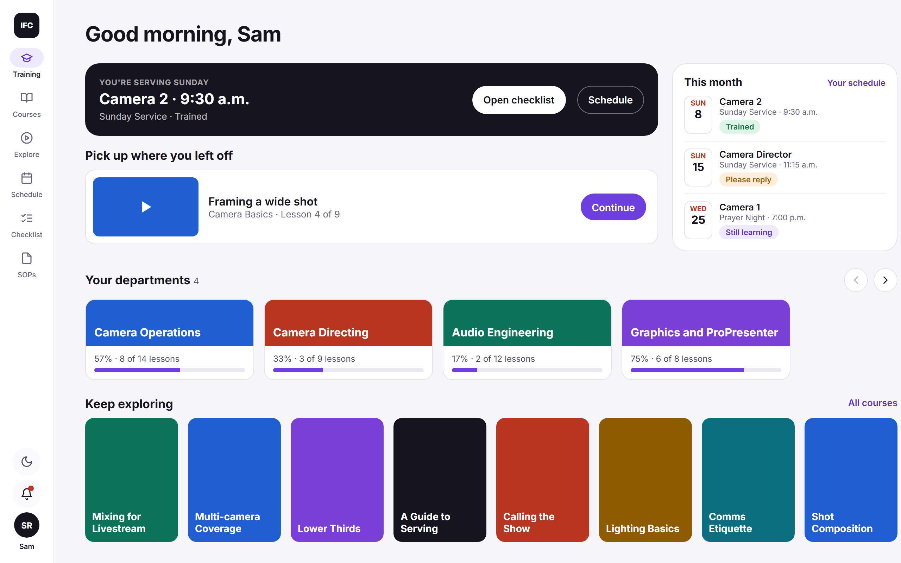
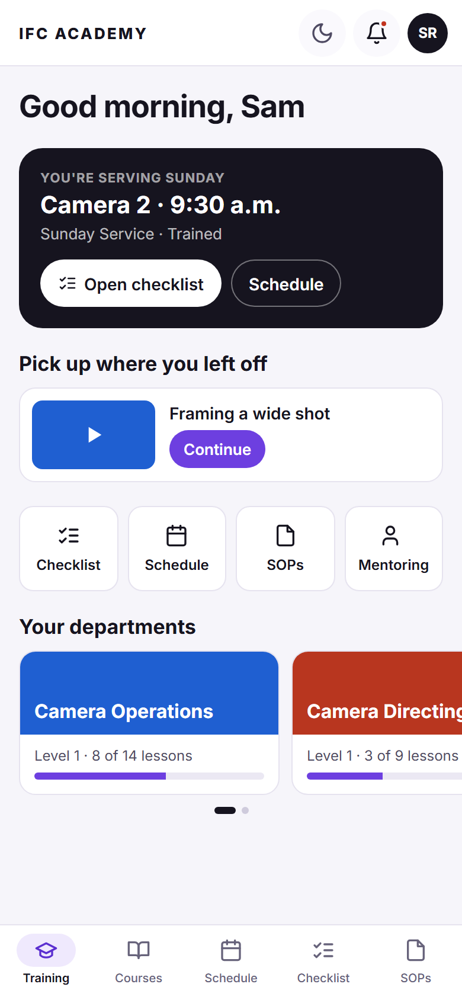
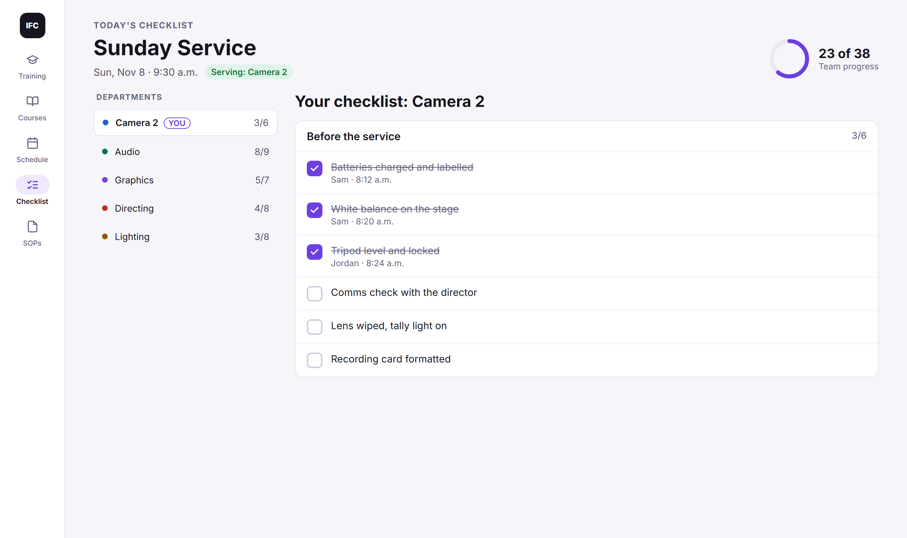

# IFC Production Academy

**Learn it. Serve it.** A training and serving app for church production teams, built for the
production ministry at Immanuel Fellowship Church in Winnipeg.

Volunteers learn their role through short video lessons, quizzes and hands-on practicals, see when
they're serving, and work through their position's checklist on Sunday, all in one place. It runs
in the browser on phones, tablets and computers, and installs like an app without an app store.



## What it does

**For volunteers**

- **Training:** courses for each department, in three levels. Each course has video lessons, a
  quiz, and a practical where a trainer watches you do the job.
- **Approved to serve:** passing the practical for a role approves you for it, automatically.
  Watching videos alone never does.
- **Schedule:** when you're serving, from Planning Center, with reminders to reply, cover requests
  and days away.
- **Checklist:** your position's pre-service checklist, ticked together live with the rest of the
  team.
- **SOPs:** the team's procedures in one searchable library.
- **Notifications:** in the app, by email, and as phone alerts, with simple choices for each.

**For leaders**

- Build and publish your own department's courses, with every version kept.
- See who's learning and who's ready, pair mentors, and welcome new people.
- Team leaders decide who serves. The app shows whether each person is trained or still learning,
  and never blocks anyone.

**On the day**

- A Service Dashboard for the producer and the booth's wall TV.

| On a phone                                                                       | The Sunday checklist                                   |
| -------------------------------------------------------------------------------- | ------------------------------------------------------ |
|  |  |

More screens: [a course](docs/images/course-web.png) and [the schedule](docs/images/schedule-web.png).
The people and services in these pictures are made up.

## How it works

1. **Join** a department. A leader welcomes you in. Any course is open to try.
2. **Learn** through lessons and quizzes. Quizzes are scored by the app.
3. **Show it** in a practical. The trainer ticks a checklist, and the leader's rule decides the
   result.
4. **Approved to serve** for that role, as soon as the practical is passed.

Finishing a course, passing a practical and being approved to serve are kept as separate records.
Departments, levels and courses are set up in the app, so adding one needs no code.

## Built with

[Next.js](https://nextjs.org) and TypeScript, hosted on
[Cloudflare Workers](https://workers.cloudflare.com); [Supabase](https://supabase.com) for the
database, sign-in and files; [Resend](https://resend.com) for email; Tailwind CSS; Vitest and
Playwright for tests. It connects to Planning Center, YouTube, Google Drive, phone alerts and
calendars, and it's designed to run on free plans.

## Try it on your computer

You need [Node.js 24](https://nodejs.org) and [Docker Desktop](https://www.docker.com/products/docker-desktop/).

```bash
npm ci
npm run db:start          # starts a local database with made-up people and courses
cp .env.example .env.local
npx supabase status -o env
```

Copy `API_URL` into `NEXT_PUBLIC_SUPABASE_URL`, and `PUBLISHABLE_KEY` (or `ANON_KEY`) into
`NEXT_PUBLIC_SUPABASE_PUBLISHABLE_KEY`, in `.env.local`. Then:

```bash
npm run dev               # open http://localhost:3000
```

**Signing in:** use the email link form. The email never leaves your computer: open Mailpit at
<http://127.0.0.1:54324> and choose the link. Sign in as one of these made-up people:

| Email                         | Who                               |
| ----------------------------- | --------------------------------- |
| `avery.volunteer@example.com` | Volunteer in Camera Operations    |
| `blake.volunteer@example.com` | Volunteer who asked to join Audio |
| `casey.leader@example.com`    | Leader of Camera Operations       |
| `devon.leader@example.com`    | Leader of Audio Engineering       |
| `emery.director@example.com`  | Production Director               |
| `frankie.admin@example.com`   | Administrator                     |

Any other address signs you up as a new volunteer.

### Useful commands

| Command                                 | What it does                        |
| --------------------------------------- | ----------------------------------- |
| `npm run dev`                           | Run the app locally                 |
| `npm test`                              | Unit tests                          |
| `npm run test:db`                       | Database tests (needs `db:start`)   |
| `npm run test:e2e`                      | Browser tests on desktop and mobile |
| `npm run lint` / `typecheck` / `format` | Code checks                         |
| `npm run db:reset`                      | Rebuild the local database          |

## Making it yours

- **Your departments and courses** are set up in the app's Admin area, not in code.
- **Your name and logo:** Admin → Branding.
- **Planning Center, email, phone alerts, a video library and the Service Dashboard** are each
  optional, and stay off until you set them up.
- **Putting it online:** follow [docs/deployment.md](docs/deployment.md).

You're welcome to use the Academy at your church. If you do, open an issue and say hello.

## Licence

[MIT](LICENSE): free to use, change and share, as long as the copyright notice comes with it.

## Documentation

- [Guides for each part of the app](docs/guides/README.md), also readable in the app at `/help`
- [Setup runbooks](docs/runbooks/) for each optional part
- [Requirements](docs/SPEC.md) and [design requirements](docs/DESIGN-REQUIREMENTS.md)
- [Decisions](docs/decisions/)
- [How we build it](CLAUDE.md), for contributors

Please don't commit secrets, real people's details, or private video links: the repository is public.
