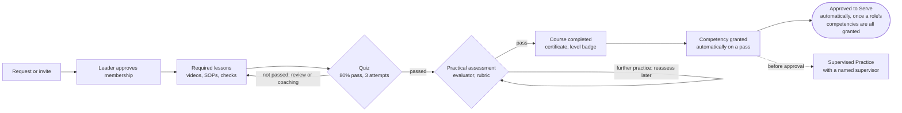

# IFC Production Academy — Combined Requirements & Design Spec

Version 1.1 · exported 2026-10-30 · Owner: G (Production Director, IFC). This file is the requirements baseline for the codebase; update it in the same pull request as any change in scope.

## Summary

IFC Production Academy is a custom, IFC-branded learning and competency platform for Immanuel Fellowship Church's production volunteers, delivered first as a responsive web app and installable PWA. Volunteers join departments, progress through three levels, learn from unlisted YouTube lessons and SOPs, pass quizzes and practical assessments, and are approved to serve by a leader. Course completion, competency approval, and authorization to serve are always tracked separately.

This version merges your *IFC Production Academy Requirements Package v1.0* with my earlier draft. Your package is the baseline: its scope, IDs (`SRS-…`), business rules, and decisions stand. My draft adds MxU style research, a concrete design token set, per-department identity, a recommended tech stack with costs, a native-app plan for later, and a progression diagram. Where we disagreed, the table below shows what this version chose.

**Status:** combined draft v1.1 for IFC leadership review. **MUST / SHOULD / MAY** follow your package's definitions.

## Where the two drafts differed

The biggest change from my draft is adopting your rule that completing a course is not the same as being approved to serve. The rest are smaller calls.

| Topic | IFC package | My earlier draft | Combined spec |
| --- | --- | --- | --- |
| Mobile delivery | Responsive web + installable PWA first; native later, based on adoption | Native iOS and Android apps in v1 | **PWA first.** Native apps planned for Phase 5 with Expo, reusing the same API |
| Readiness model | Course completion, competency approval, and Approved to Serve kept separate | One status ladder ending in "Certified to serve" | **Your three-way separation**, plus supervised-practice state |
| Scheduling and mentoring | Basic scheduling and mentoring in MVP | Out of scope for v1 | **In MVP** as you specified; advanced rotations later |
| Quiz attempts | 80% pass, 3 attempts, then review or coaching | 80% pass, unlimited retries | **80%, 3 attempts**, configurable per course |
| Video completion | Never claim full watch verification | Auto-complete at 90% watched | **Mark complete by learner**; watch percentage from the YouTube player recorded as an informal signal only, never as proof |
| Sign-in | Google + email (password or passwordless, TBD) | Apple, Google, magic link | **Email magic link only** (decided 2026-10-30: membership is approved by a leader, so one simple sign-in path is enough). Revisit Apple and Google sign-in when native iOS ships |
| Roles | Volunteer, Trainer/Evaluator, Department Leader, Production Director, Platform Admin | Volunteer, Lead, Content editor, Super admin | **Your five roles**; content authoring is a permission, not a separate role |
| Content governance | Draft, pending review, published, archived, superseded; approver publishes; versioned | Draft and published only | **Versioned, author publishes** (decided 2026-10-30): department leaders publish their own department's content; every publish is a version with a change note and can be rolled back; optional review per department |
| Accent colour | Single purple accent (#7C3AED) | Church brand colour plus one accent per department | **Purple stays the action colour**; department hues used only for covers, icons, and progress rings |
| Success metrics | Measure baselines in pilot, no targets yet | Specific 3-month targets | **Baselines first**; my targets kept as optional goals to set after the pilot |
| Tech stack and cost | Left to discovery | Recommended stack, about $25 to $105 a month | **Recommendation included** for Phase 0 to confirm |
| Department names | Camera Operations, Audio Engineering, Computer Graphics and ProPresenter, Camera Directing, Lighting Operations | Shorter names | **Your names** |

**Already settled by your package:** unlisted YouTube (with the warning that unlisted links are shareable, not secure), invitations plus requests for enrolment, digital certificates with expiry off by default, email notifications first, and Camera Operations Level 1 as the pilot.

## 1. Product

**Vision:** Equip every IFC production volunteer to serve confidently, competently, and consistently through clear learning pathways, practical assessment, and accessible resources.

### Objectives

1. Reduce the time it takes to onboard a new production volunteer.
2. Standardize core operating practices across departments.
3. Show every volunteer what to learn next and how to progress.
4. Track course completion separately from competency and authorization to serve.
5. Help leaders see training gaps, assessment backlogs, and staffing constraints.
6. Preserve knowledge in searchable, version-controlled SOPs.
7. Deliver an installable mobile experience without native apps at launch.
8. Add departments, levels, courses, integrations, and capabilities without redevelopment.

### Users

| User | Who they are | What they need most |
| --- | --- | --- |
| Volunteer | Learning one or more production roles, often on a phone | Find training, resume lessons, see feedback, know whether they are approved to serve |
| Trainer / Evaluator | Experienced volunteer or leader | A queue of learners to assess, consistent rubrics, a quick way to record feedback |
| Department Leader | Owns one department's curriculum and readiness | Approve members, draft curriculum, see who is ready, fill schedule roles |
| Production Director | Ministry-wide owner (G) | Cross-department readiness, publishing control, accountable overrides |
| Platform Administrator | Accounts, settings, security, maintenance | Manage roles, audit logs, recovery. May be the same person as the Production Director, but kept as a separate permission set |

### Departments

Departments are configurable records, never hardcoded. Lighting Operations launches as **Coming Soon** and is activated by an administrator when its curriculum is ready.

| Department | Status at launch | Identity hue (covers, rings) |
| --- | --- | --- |
| Camera Operations | Active (pilot) | Blue |
| Audio Engineering | Active | Teal |
| Computer Graphics and ProPresenter | Active | Violet |
| Camera Directing | Active | Coral |
| Lighting Operations | Coming Soon | Amber |

### Three-level framework

| Level | Focus | Outcome |
| --- | --- | --- |
| 1. Foundations | The department's role in a service, equipment names, essential controls, basic procedures, supervised basic tasks | Ready for supervised practice |
| 2. Proficiency | Routine tasks done independently, standard techniques, common troubleshooting, scenario quizzes and practicals | May be approved for independent assignments within scope |
| 3. Advanced and Leadership | Advanced techniques, complex troubleshooting, live-service judgement, mentoring | Eligible for advanced assignments and trainer responsibilities |

Level names, required lessons, prerequisites, quiz rules, rubrics, and approval requirements are configurable. A level may hold several courses.

### Product principles

1. **Competency over content consumption:** watching a video does not prove readiness.
2. **Progress is visible:** volunteers always know their status and next step.
3. **Safe authorization:** completion and authorization to serve are separate.
4. **Easy for volunteers, powerful for leaders.**
5. **Mobile-first:** essential workflows work well on phones.
6. **Reusable by design:** shared templates and configurable rules.
7. **Content ownership:** every course and SOP has an owner and review date.
8. **Privacy by default:** assessment and mentoring records visible only to authorized people.
9. **Purposeful polish:** motion clarifies progress rather than decorating.
10. **Phased delivery:** a dependable learning foundation before advanced scheduling or native apps.

### Scope

**MVP:** authentication and onboarding; role-based permissions; department browsing, invitations and requests; department and course administration; three-level pathways; lessons with unlisted YouTube embeds; SOP library; progress tracking; quizzes; practical assessments with feedback; leader competency approval; certificates; volunteer and leader dashboards; reports and CSV/Excel export; email notifications; basic scheduling (events, roles, availability, confirmations, reminders); mentoring (assignments, shared feedback, goals, follow-ups); responsive PWA; audit logs; backup and recovery.

**Later phase:** recurring rotations and auto-balancing; shift swaps; native iOS and Android apps; calendar integrations; advanced analytics; wider offline access; automated recertification; Planning Center or other church-system integration; further ministry departments.

**Out of scope unless approved:** uploading or transcoding video on the platform, replacing YouTube (the church video library on IFC's own NAS was approved as a second source on 2026-10-30, see SRS-LESSON-002), public social features or open messaging, payroll or finance, full church management, authorization from video watching alone, offline YouTube playback.

## 2. Functional requirements

IDs come from your package. Rows marked **ADD-** are additions from my draft that fit your baseline. Level: M = MUST, S = SHOULD, Y = MAY.

### Identity and accounts

| ID | Requirement | Level |
| --- | --- | --- |
| SRS-AUTH-001 | Secure sign-in through the selected identity provider | M |
| SRS-AUTH-002 | Email sign-in by passwordless magic link only (decided 2026-10-30; Google sign-in dropped) | S |
| SRS-AUTH-003 | Leaders invite volunteers to the platform and optionally a department | M |
| SRS-AUTH-004 | Suspend or deactivate accounts without erasing training history | M |
| SRS-AUTH-005 | Secure sessions with expiry and revocation | M |
| SRS-AUTH-006 | Users view and update permitted profile fields | M |
| SRS-AUTH-007 | Account status, role, and permission changes audited | M |
| ADD-AUTH-01 | Invites by link and QR code (for use at volunteer nights), plus CSV bulk import | S |

### Authorization

| ID | Requirement | Level |
| --- | --- | --- |
| SRS-RBAC-001 | Every protected server operation checks permissions | M |
| SRS-RBAC-002 | Permissions scoped by department | M |
| SRS-RBAC-003 | Users may hold several roles | Y |
| SRS-RBAC-004 | Deny by default | M |
| SRS-RBAC-005 | Separate permissions for administration, publishing, evaluation, competency approval, scheduling | M |
| SRS-RBAC-006 | Private mentoring notes use separate access rules | M |

### Department membership

| ID | Requirement | Level |
| --- | --- | --- |
| SRS-MEM-001 | Volunteers request membership in available departments | M |
| SRS-MEM-002 | Leaders invite volunteers to departments | M |
| SRS-MEM-003 | Leaders approve or decline, with timestamp and actor recorded | M |
| SRS-MEM-004 | Membership changes never delete training history | M |
| SRS-MEM-005 | Restricted content only while membership or explicit permission is active | M |
| SRS-MEM-006 | Department pages browsable before joining; member resources protected | Y |
| ADD-MEM-01 | Onboarding lets a new volunteer pick departments of interest from photo tiles | S |

### Curriculum

| ID | Requirement | Level |
| --- | --- | --- |
| SRS-CUR-001 | Authorized creators create, edit, and save drafts | M |
| SRS-CUR-002 | Configurable departments, levels, courses, modules, lessons, prerequisites, completion rules | M |
| SRS-CUR-003 | Course title, description, objectives, duration, owner, status, revision metadata | M |
| SRS-CUR-004 | Required and optional lessons | M |
| SRS-CUR-005 | Publishing requires `course.publish` for the department. Department leaders hold it for their own department; a department can turn on "require review" so a second person publishes (decided 2026-10-30) | M |
| SRS-CUR-006 | States: draft, published, archived, superseded; pending review only when the department requires review | M |
| SRS-CUR-007 | Published changes create a revision | M |
| SRS-CUR-008 | Updates never erase historic completion or certification | M |
| SRS-CUR-009 | Activate or deactivate a department without deployment | M |
| ADD-CUR-01 | Drag-and-drop ordering of modules and lessons | S |
| ADD-CUR-02 | Equipment tags on lessons (for example ATEM, X32, ProPresenter 7) for search and filters | S |
| ADD-CUR-03 | A lesson can be reused across departments (for example comms etiquette in Camera and Directing) | Y |

### Lessons and media

| ID | Requirement | Level |
| --- | --- | --- |
| SRS-LESSON-001 | Title, description, objectives, duration, order, completion rule | M |
| SRS-LESSON-002 | Reference an unlisted YouTube video or playlist, or a file in the church video library (UniFi NAS, streamed through the app with a per-person access check; added 2026-10-30) | Y |
| SRS-LESSON-003 | Validate and safely store YouTube URLs or IDs | M |
| SRS-LESSON-004 | Useful fallback when an embed is unavailable | M |
| SRS-LESSON-005 | Documents, links, checklists, diagrams, captions, transcripts | Y |
| SRS-LESSON-006 | Never claim full watch verification | M |
| SRS-LESSON-007 | Unlisted links treated as shareable secrets, not access control | M |
| SRS-LESSON-008 | Warn creators who mark a resource sensitive but deliver it via an unlisted link | M |
| ADD-LESSON-01 | Paste a YouTube URL and the title, duration, and thumbnail fill in automatically | S |
| ADD-LESSON-02 | Branded in-app player; raw YouTube link not shown to volunteers | S |
| ADD-LESSON-03 | Resume at the last playback position on any device; watch percentage stored as an informal signal | S |

YouTube note: **Private** videos cannot be embedded for volunteers, so lessons must use **Unlisted** videos, as your package decided. Truly sensitive material belongs in authenticated storage (SRS-SOP-006), such as the church video library, which plays only for signed-in people who may read the lesson. Setup: [docs/runbooks/nas-media.md](runbooks/nas-media.md).

### Progress

| ID | Requirement | Level |
| --- | --- | --- |
| SRS-PROG-001 | Progress tracked per user and lesson version | M |
| SRS-PROG-002 | Course and level progress derived from completion rules | M |
| SRS-PROG-003 | Resume on another device | M |
| SRS-PROG-004 | Idempotent progress updates | M |
| SRS-PROG-005 | Completion timestamps and assessment outcomes recorded | M |
| SRS-PROG-006 | Statuses: Not Started, In Progress, Awaiting Assessment, Further Practice Required, Completed, Approved to Serve | M |
| SRS-PROG-007 | Completion separate from competency and serving authorization | M |
| SRS-PROG-008 | Revised courses apply a policy: keep, review, or retrain | M |
| ADD-PROG-01 | Progress rings and percentages on every department, level, and course card, always with a text label | S |

### Quizzes

| ID | Requirement | Level |
| --- | --- | --- |
| SRS-QUIZ-001 | Multiple choice, multiple select, true/false, scenario questions | M |
| SRS-QUIZ-002 | Configurable pass score, attempts, order, feedback rules | M |
| SRS-QUIZ-003 | Default 80% pass, 3 attempts | S |
| SRS-QUIZ-004 | After failed attempts, direct to review or coaching | S |
| SRS-QUIZ-005 | Attempts record learner, version, answers, score, outcome, time | M |
| SRS-QUIZ-006 | Correct answers hidden until policy allows | M |
| SRS-QUIZ-007 | Leaders review results for their department | M |
| ADD-QUIZ-01 | Image-based questions (for example "which fader is muted?") | S |

### Practical assessments and competency

| ID | Requirement | Level |
| --- | --- | --- |
| SRS-ASSESS-001–002 | Practical checklists: observable criteria with descriptions, each required or optional, plus a pass rule (for example every required item and at least 80% of all items) set by the department leader | M |
| SRS-ASSESS-003 | Outcomes: Pass, Further Practice Required, Not Yet Assessed. **The system computes the outcome** from the observed criteria and the pass rule; the evaluator only records what they observed and never chooses the outcome (decided 2026-10-30) | M |
| SRS-ASSESS-004 | Record learner, observer, checklist version, date, each criterion observed, computed result, feedback | M |
| SRS-ASSESS-005 | Reassessment per configured rules | M |
| SRS-ASSESS-006 | Decisions and corrections audited | M |
| SRS-ASSESS-007 | Learners see shareable feedback | M |
| SRS-ASSESS-008 | One assessment does not authorize the whole department unless policy says so | M |
| SRS-COMP-001–002 | Competency records separate from completion, scoped to skill or equipment, with date and the assessment that granted them. **A passed practical grants the competency automatically**; no separate approval (decided 2026-10-30) | M |
| SRS-COMP-003 | States: Not Assessed, Supervised Practice, Approved, Suspended, Expired | S |
| SRS-COMP-004 | Leaders define competencies required for serving roles. **Approved to Serve is granted automatically** when every required competency is approved, and withdrawn if one is suspended or expires; it stays its own record (decided 2026-10-30) | M |
| SRS-COMP-005–006 | Scheduling checks competency; no silent unqualified assignment | M |
| SRS-COMP-007 | Supervised-practice assignments with a named supervisor | S |
| SRS-COMP-008 | Overrides need permission, reason, audit | M |
| SRS-COMP-009 | Expiry configurable, off by default | M |
| ADD-ASSESS-01 | Volunteer can tap **Request assessment** when ready, which lands in the trainer's queue | S |

### Certificates and achievements

| ID | Requirement | Level |
| --- | --- | --- |
| SRS-CERT-001 | Issued only when requirements are met | M |
| SRS-CERT-002 | Recipient, achievement, department, date, unique reference | S |
| SRS-CERT-003 | Linked to the curriculum version earned | M |
| SRS-CERT-004 | PDF download or verification page, subject to privacy | S |
| SRS-CERT-005 | Revocation restricted and audited | M |
| ADD-CERT-01 | A level badge in the department's hue for each completed level | S |

### SOP library, notifications, scheduling, mentoring, reports, audit

These follow your package unchanged: **SRS-SOP-001–006** (searchable, versioned SOPs with owners and review dates; authenticated access for restricted files), **SRS-NOTIF-001–006** (email first, configurable, PWA push later), **SRS-SCHED-001–011** (events, roles, availability, states, conflict and competency checks, supervisor on supervised practice, personal schedule, reminders), **SRS-MENTOR-001–005** (mentor assignments, goals, private versus shared notes, audited access), **SRS-REPORT-001–007** (department and cross-department reports separating completion, competency, and authorization; exports without mentoring notes), and **SRS-AUDIT-001–004**.

| ID | Addition | Level |
| --- | --- | --- |
| ADD-NOTIF-01 | Gentle reminder after 14 days of inactivity (configurable) | S |
| ADD-SCHED-01 | Quick reference: a service-day view with the SOPs for the volunteer's assigned role two taps from Home | S |
| ADD-REPORT-01 | Readiness matrix for the Production Director: approved volunteers per role per department | S |

## 3. Progression, business rules and workflows

*Finishing a course is not the same as being approved to serve. Repeated for each level in each department; every step is recorded separately.*

A volunteer moves from membership through lessons, a quiz, and a practical assessment to a completed course. The system decides every result (decided 2026-10-30): lessons are marked complete by the volunteer, quizzes are scored automatically, and a practical is passed when the observed checklist meets the leader's pass rule. A passed practical grants the competency, and Approved to Serve follows once a role's competencies are all granted. These remain separate records, and a quiz alone never makes anyone Approved to Serve.

### Business rules

1. A volunteer may belong to several departments.
2. Membership grants access to content, not serving authorization.
3. Course completion is derived from the course's configured requirements.
4. Passing a quiz never replaces a required practical assessment.
5. Competency approval is scoped to the skill, equipment, or role it names.
6. Leaders approve only within their scope unless delegated more.
7. Level 2 and 3 may require all prerequisites completed and approved.
8. Content revisions never erase historic achievement.
9. Scheduling checks competency prerequisites.
10. Supervised practice requires a named, qualified supervisor where policy says so.
11. Overrides are authorized, justified, and audited.
12. An unlisted YouTube link is not protected access.
13. Mentoring notes are private by default; only designated feedback is shared.
14. Certificates are issued only when rules are satisfied.
15. Deactivation preserves required history per the retention policy.

### Primary workflows

| Workflow | Steps | Acceptance test |
| --- | --- | --- |
| A. Join a department | Sign in or accept invite, view departments, request or accept, leader approves, pathway appears, start Level 1 | No restricted resource opens before approval |
| B. Complete a course | Open course, complete required lessons, take quiz, status becomes Awaiting Assessment, observer ticks the practical checklist, the system computes the result and grants the competency, Approved to Serve follows automatically when a role's competencies are complete, dashboard and notification update | Never Approved to Serve just because a video was marked complete or a quiz was passed; the observer cannot choose the outcome |
| C. Publish curriculum | Leader drafts, sets prerequisites, lessons, rules, resources, adds a change note, publishes; the published version goes live and earlier versions stay in history for rollback; publisher and version recorded; departments that require review send it to a second person instead | A user without publish rights for the department cannot make content live |
| D. Schedule a role | Create event and roles, set competency needs, assign, system checks conflicts and competency, confirm or block/warn, supervisor named for supervised practice, notify | No silent confirmation of an unqualified volunteer |
| E. Maintain an SOP | Create or update, review and publish, keep old version, review reminders, mark superseded | Current SOP is clearly distinguishable from obsolete versions |

## 4. Roles and permissions

Roles are scoped per department (someone can lead Audio and be a volunteer in Camera), and permissions are named capabilities such as `course.publish` or `competency.approve`, so new roles like Campus Lead need no code. "Own" means within the department or learners assigned to them.

| Action | Volunteer | Trainer / Evaluator | Department Leader | Production Director | Platform Admin |
| --- | --- | --- | --- | --- | --- |
| Browse departments, request to join | Yes | Yes | Yes | Yes | Yes |
| Learn: lessons, quizzes, SOPs | Own departments | Own departments | Own department | All | Only if granted |
| See own progress, feedback, schedule | Yes | Yes | Yes | Yes | Yes |
| Approve or invite members | No | No | Own | All | No |
| Draft curriculum and SOPs | No | No | Own | All | No |
| Publish curriculum | No | No | Own | All | No |
| Record practical observations (the system decides the result) | No | Assigned learners | Own | All | No |
| Suspend or restore a competency (with reason) | No | No | Own | All | No |
| Schedule events and roles | No | No | Own | All | No |
| Override competency on schedule (with reason) | No | No | Only if delegated | Yes | No |
| Mentoring: shared feedback | Own (view) | Assigned learners | Own | All | No |
| Mentoring: private notes | No | Own notes | Only if granted | Only if granted | Only if granted, audited |
| Reports and exports | No | Assigned learners | Own | All | Operational only |
| Users, roles, departments, settings | No | No | No | Delegate roles | Yes |
| Audit log | No | No | No | View | Yes |

## 5. Data model and extensibility

Everything a volunteer sees is configuration, so Lighting Operations goes live by an administrator flipping its status, not by a release. Your package's entities stand; my additions are marked.

| Area | Entities | Notes |
| --- | --- | --- |
| Identity and access | User, Role, UserRole (optionally department-scoped), Organization and Campus (**added**) | Campus is optional now, ready for multi-site |
| Departments | Department (name, status incl. Coming Soon, order, **added:** icon, hue, cover image, enrolment mode), DepartmentMembership | Membership keeps request and invitation history |
| Curriculum | Course, CourseVersion, Module, Lesson, Resource, Enrollment | Lesson type-specific content in a structured field so new lesson types can be added |
| Video (**added**) | VideoSource: provider (YouTube or church video library now; Vimeo or Mux later), external ID or library path, duration, thumbnail | Swapping hosts later keeps lesson IDs and progress |
| Progress | LessonProgress (per lesson version, **added:** last playback position, informal watch %) | Idempotent writes |
| Assessment | Quiz, QuizQuestion, QuizAttempt, PracticalRubric, PracticalAssessment | All linked to the version used |
| Competency | Competency, CompetencyRecord | Separate from completion |
| Recognition | Certificate, **added:** Badge and Award (per level) | Certificate tied to curriculum version |
| Knowledge | SOP, SOPVersion | Owner and review date |
| Scheduling | Event, ProductionRole, EventAssignment (with competency check result and supervisor), Availability |  |
| Mentoring | MentorRelationship, MentoringSession, MentoringNote (private or shared) | Restricted access |
| Platform | Notification, AuditEvent, **added:** FeatureFlag | Flags switch modules on per organization |

**Integrity:** stable IDs, consistent timestamps shown in local time (America/Winnipeg), history linked to versions, no duplicate active memberships or assignments, database constraints plus server validation, retention rules for personal data.

**Extending later**

- **New department:** create it, set hue and icon, add levels and courses, assign a leader. No code.
- **New lesson type** (for example an interactive console walkthrough): add one renderer and a type value.
- **New video host:** add a VideoSource provider.
- **New modules** (advanced rotations, Planning Center sync, team messaging): built against the same API and turned on with feature flags.
- **Native apps:** call the same documented API as the PWA (your section 18).
- **Webhooks** (MAY): events such as `competency.approved` for other church tools.

## 6. Non-functional requirements and testing

| Area | Requirement |
| --- | --- |
| Security | HTTPS everywhere; server-side permission checks (database row-level security recommended); least privilege; secret management; input validation; protection against common web vulnerabilities; rate limiting on sensitive endpoints; authenticated access for restricted files; audit logging; regular dependency updates. Optional two-factor for admins (**added**). |
| Privacy | Collect only what is needed; approved retention schedule; restricted mentoring records; documented deactivation and correction process; review Canadian privacy law (PIPEDA, and Manitoba guidance) before launch. If under-18 volunteers serve, require guardian consent and hide their profiles from other volunteers (**added**). |
| Reliability | Automated backups, documented and tested restore; graceful network handling; no false success messages; idempotent retries; progress saved at least every 15 seconds during a lesson (**added**). |
| Performance | Dashboard and navigation requests within about 2.5 s under expected load, excluding YouTube startup; immediate feedback on primary actions; paginated or async large reports; optimized assets; usable on typical mobile data. Targets to be measured, not assumed. |
| Accessibility | WCAG 2.2 AA; keyboard access and visible focus; semantic structure; contrast; screen reader and text scaling; reduced motion; never colour alone for status; captions and transcripts encouraged; touch targets at least 44 by 44 px (**added**). |
| Maintainability | UI, domain logic, and data access separated; version control and automated tests; dev, staging, production; documented config, deploys, migrations, recovery; no hardcoded departments; feature flags. |
| Compliance (**added**) | YouTube API Services Terms (no ad removal, no downloads); when native apps ship, App Store and Play Store rules on sign-in and in-app account deletion. |
| Observability (**added**) | Error reporting and privacy-respecting usage analytics (for example lesson drop-off) visible to the Production Director. |

**Testing** follows your section 20: unit tests for business rules, integration tests for persistence and authorization, end-to-end tests of workflows A to E, permission tests at every role and department boundary, cross-device progress sync, quiz scoring and attempt limits, curriculum versioning, scheduling conflict and competency checks, PWA install on iOS Safari, Android Chrome, and desktop, responsive layouts, accessibility, backup restore, email duplicate handling, and a security review before launch.

## 7. Design requirements

The direction is "backstage cinema": dark, calm surfaces like a control room, lit by real photography of IFC's own team and a single purple accent for action. It should feel professional, welcoming, confident, organized, creative, and encouraging, never like a school portal or a generic church site.

### What we take from MxU

MxU ([getmxu.com](https://getmxu.com)) is a church production training platform with 1,000+ videos, pathways, quizzes, progress tracking, and iOS and Android apps. Patterns worth borrowing:

- **Real production photography as the hero** (a front-of-house engineer mid-service), not stock images or illustrations.
- **Short, direct, second-person copy** that names a frustration then the fix ("Training gets pushed to next week. Again.").
- **Cards pairing a tall image with a bold heading and one or two lines**; text calls to action with an arrow ("Explore training →").
- **Pathways that move volunteers forward automatically.**

Where IFC goes further: your people, your gear, and your room on every screen; progress visible everywhere; the completion versus approval distinction made obvious. I couldn't load MxU's stylesheet, so the tokens below are ours, not a copy.

### Colour tokens

> **Superseded for visual values (2026-10-30):** colours, type sizes, geometry, and motion now follow [DESIGN-REQUIREMENTS.md](DESIGN-REQUIREMENTS.md) §4–5, implemented in `app/globals.css`. The principles in this section still apply: one purple action colour, department hues as minor accents only, status never shown by colour alone, and contrast checked before shipping. The table below is the original palette, kept for history.

Your palette is kept, with two contrast fixes I checked against WCAG 2.2 AA (4.5:1 for normal text):

| Token | Dark (primary) | Light (SHOULD) | Use |
| --- | --- | --- | --- |
| Background | #080808 | #F7F7F8 | App canvas |
| Surface | #101010 | #FFFFFF | Navigation, panels |
| Card | #151515 | #FFFFFF | Course and content cards |
| Hover | #1C1C1C | #F0F0F2 | Hover, selected |
| Border | #292929 | #E4E4E8 | Dividers, outlines |
| Primary text | #F5F5F5 | #111114 | Main text |
| Secondary text | #A3A3A3 | #5B5B66 | Supporting text |
| Muted text | **#8A8A8A** (was #737373) | #6B6B76 | Metadata |
| Accent | #7C3AED | #6D28D9 | Button fills, selected nav (white text on it is 5.7:1) |
| Accent light | #A78BFA | #7C3AED | **Accent-coloured text and links on dark**, progress emphasis |
| Success | #22C55E | #15803D | Completed |
| Warning | #F59E0B | #B45309 | Pending, attention |
| Error | #EF4444 | #B91C1C | Errors, failed outcomes |
| Information | #60A5FA | #1D4ED8 | Informational |

**Contrast fixes:** #737373 muted text reaches only 3.85:1 on cards (#151515), so it becomes #8A8A8A (5.29:1). #7C3AED as text on the background is 3.51:1, so purple text and links use #A78BFA (7.36:1); #7C3AED stays for fills.

**Department hues** (covers, icons, progress rings, level badges only; never buttons): Camera Operations blue #4F8CFF, Audio Engineering teal #2BD4A4, Computer Graphics and ProPresenter violet #B07CFF, Camera Directing coral #FF6B57, Lighting Operations amber #FFC23D. They help volunteers recognise a department at a glance while purple stays the one action colour.

### Type, layout, imagery

- **Typeface:** IBM Plex Sans, a technical grotesk, with IBM Plex Mono for small uppercase labels (levels, versions) and tabular numerals for progress and metrics. Sizes follow DESIGN-REQUIREMENTS §4.2 (hero, page title, section, card, body 15, metadata 12–13); headings with slightly tight tracking; weights 400, 500, and 600 only.
- **Layout:** 8 px spacing scale; card radius 12, button and input radius 8, pills fully round (DESIGN-REQUIREMENTS §4.3); controls 36 px tall with a mouse and 44 px on touch screens; 20 px mobile margins; 12-column desktop grid with a readable max width; rows and hairline dividers before boxed cards; restrained borders over heavy shadows.
- **Imagery:** a consistent photo shoot of IFC volunteers at each position (deep shadows, warm stage light), one cover per department, a matching line-icon set.
- **Brand:** IFC logo and assets confirmed before high-fidelity design.

### Motion

Short transitions of 150 to 250 ms; restrained progress animations; a small confirmation when a lesson completes; one tasteful celebration (a light sweep in the department hue) for a level or certificate. Respect reduced motion, never delay navigation, no looping decoration, no sound or heavy confetti, and always a non-animated status equivalent.

### Writing style

Warm, direct, encouraging. Use "Continue Learning", "Your next step", "Ready for Practical Assessment", "Further Practice Recommended", "Approved for Independent Service", "Review this procedure". Avoid jargon without explanation, shame, ambiguous completion labels, childish tone, and emoji on operational screens.

### Components

Buttons (primary, secondary, tertiary, destructive), inputs, navigation and breadcrumbs, course and level cards, lesson rows, progress bars and rings, status badges, metric cards, tables and filters, dialogs, toasts and inline alerts, empty states and skeletons, rubric rows, calendar event cards, resource rows, certificate and achievement cards. Each defines default, hover, focus, pressed, disabled, loading, error, mobile behaviour, and accessible labelling.

**Design deliverables:** a Figma file with tokens and the component library, wireframes then high-fidelity designs for every screen in section 8 at mobile, tablet, and desktop, and a clickable prototype tested with representative volunteers and leaders.

## 8. Navigation, screens and mobile

### Navigation by role

| Role | Destinations | Mobile pattern |
| --- | --- | --- |
| Volunteer | Home, My Learning, Departments, SOP Library, My Schedule, Achievements, Profile | Bottom bar: Home, Learn, Schedule, SOPs, More |
| Leader | Overview, Volunteers, Departments, Curriculum, Assessments, Scheduling, SOP Library, Reports, Settings | Bottom bar plus a Lead tab; heavy editing on tablet or desktop |
| Administrator | Platform Overview, Users and Roles, Department Configuration, Curriculum Governance, Notifications and Integrations, Audit Logs, System Settings | Desktop side navigation |

Only areas a user is authorized for are shown.

### Key screens

Your full inventory (section 26 of your package) stands. These are the screens that carry the premium feel and need the most design attention:

| Screen | What it must do |
| --- | --- |
| Sign-in and invitation | Full-bleed IFC team photo, logo, email sign-in link (the only sign-in method, decided 2026-10-30); invite links and QR codes open straight into the right department |
| Onboarding | Pick departments of interest from large photo tiles in each department's hue; set notification preferences |
| Home dashboard | Answers "Where am I? What next? Am I ready?": greeting, a dominant Continue Learning card, department progress rings with text labels, next assessment or action, upcoming serving, recent achievements |
| Department overview | Cinematic cover, purpose, three level cards; locked levels say what is missing ("Pass the Level 1 practical to unlock"); SOPs and leader contact |
| Course detail | Outcomes, duration, required vs optional, lesson list with progress, quiz and practical requirements, Start or Continue |
| Lesson player | Desktop: video with outline sidebar and resources panel. Mobile: video first, objectives, expandable materials, clear Mark complete, previous and next, outline drawer; landscape full screen. Never implies the video was fully watched |
| Quiz | One question at a time, progress, large answer targets, confirm before submit, result with score and next step (continue, review, or request coaching) |
| Practical assessment (observer, phone or tablet first) | Learner and competency, one row per checklist item with Observed / Not observed, optional evidence and feedback, confirm; the system then shows the computed result and what is missing; clear draft vs submitted |
| Achievement moment | Level badge reveal in the department hue, certificate link; calm and short |
| Leader dashboard | Cards for active, in progress, awaiting assessment, further practice, approved, schedule gaps; actionable queues below; every number links to its records |
| Readiness overview (Production Director) | Matrix of departments by role showing approved, supervised, and in-training counts |
| Curriculum editor | Course details, objectives, level and prerequisites, lesson builder (paste a YouTube URL), resources, quiz and rubric setup, completion rules, preview, Save draft and Submit for review; visible save status |
| Scheduling | Calendar and list toggle; each assignment shows competency status in words, supervisor if supervised, and why anything is blocked |
| SOP library | Search, category and department filters, status, last reviewed, owner; detail page shows Current, Under review, or Superseded prominently |

Every screen also needs empty, loading, error, offline, success, and permission-denied states, including an unavailable YouTube embed and an outdated SOP.

### Responsive

Mobile: one column, reachable primary actions, accessible touch targets, cards instead of wide tables, sticky controls that never cover content. Tablet: two columns for learning and assessment, built for trainers at the camera position or front of house. Desktop: side navigation for leaders and admins, efficient tables, readable widths.

### PWA (launch)

App name, icon, theme colour, install metadata; install prompt on Android and install guidance on iOS (Share, then Add to Home Screen); cached app shell and safe static assets; visible connectivity and sync state; no indiscriminate caching of sensitive records; no promise of offline video; tested install and update on iOS Safari, Android Chrome, and desktop; reliable sign-out on shared production computers. Web push on iOS works only after the app is installed to the Home Screen (iOS 16.4 and later), so email remains the guaranteed channel.

### Native apps (Phase 5, if adoption justifies)

- **One codebase** with React Native and Expo, calling the same API as the PWA.
- **Sign in with Apple** must be offered alongside Google on iOS, and **in-app account deletion** is required by both stores.
- Native push (APNs and FCM), haptics, Face ID or fingerprint unlock, iPad two-column layouts.
- YouTube still plays through its embedded player; no downloads or background playback.
- Publish under IFC's own developer accounts (Apple $99 a year, Google $25 one time); Apple's unlisted app distribution can keep it out of public search.

## 9. Architecture, roadmap and launch

### Architecture (stack decided 2026-10-29)

A custom build on managed services fits your "balanced" budget: premium design and full data ownership, with no servers to look after.

| Layer | Choice | Monthly cost (USD) |
| --- | --- | --- |
| Web app and PWA | Next.js (or a similar React framework) on Cloudflare Pages / Workers, with the design tokens as shared code | $0 |
| Database | Supabase Free Postgres with row-level security, kept awake by a daily job | $0 |
| Sign-in | Supabase Auth: email magic-link sign-in | $0 |
| Files | Supabase Storage, private bucket with signed links | $0 |
| Video | Unlisted YouTube via the official embedded player, and the church video library (UniFi NAS behind a Cloudflare Tunnel and Access service token, streamed by the Worker after an RLS check); a VideoSource record allows Vimeo or Mux later | $0 |
| Email | Resend (confirmed) | $0 |
| Backups | Nightly encrypted backup to IFC's Google Drive (confirmed) | $0 |
| Monitoring | Sentry (errors), PostHog (usage) | $0 |
| Native apps (Phase 5) | React Native with Expo on the same API | $0 to $19, plus store fees |

That is **$0 a month** at launch, plus an optional custom domain. Free limits and upgrade triggers are below. For comparison, MxU's Training plan is about $129 a month for up to 50 members, without your own branding or competency model.

### Chosen stack: Supabase Free with keep-alive ($0 a month)

On 2026-10-29 IFC chose **Supabase Free**, with a daily keep-alive job so the project never reaches Supabase's 7-day inactivity pause, whether or not anyone signs in. Supabase counts "API calls or sending requests through a connected application" as activity, and "a few user requests to the database each day" is typically enough ([Supabase: Project Pausing](https://supabase.com/docs/guides/platform/free-project-pausing)).

| Layer | Service | Free limit (Oct 2026) | Notes |
| --- | --- | --- | --- |
| Web app and PWA | Cloudflare Pages / Workers | 500 builds a month | Vercel's free Hobby plan is for "non-commercial, personal use" only, so it is not used |
| Database, sign-in, files | Supabase Free | 500 MB database, 1 GB files, 5 GB egress, 50,000 monthly active users, 2 projects ([Supabase pricing](https://supabase.com/pricing)) | One product for Postgres, magic-link sign-in, file storage for SOPs, and row-level security |
| Email | Resend (also Supabase's sign-in email sender) | 3,000 a month, 100 a day | Confirmed by IFC |
| Video | Unlisted YouTube; church NAS through Cloudflare Tunnel | Free | Unchanged; NAS needs an always-on device at church and enough upload bandwidth |
| Keep-alive and backups | GitHub Actions scheduled jobs | 2,000 free minutes a month on a private repo | See below |
| Errors and analytics | Sentry Developer, PostHog Free | Free tiers |  |
| Domain | Free `*.pages.dev` address, or a custom domain | About $10 to $20 a year | The only likely cost |

### Keep-alive design

The pause needs 7 straight days with no activity. Twice a week would technically be enough, but the job costs nothing, so it runs **daily**: if a run fails or GitHub skips one, six more chances remain before any pause.

| Safeguard | Design |
| --- | --- |
| Daily keep-alive | GitHub Actions job every day at 12:00 America/Winnipeg. It makes a real read through the Supabase API (for example, counting published courses) and fails loudly if the request does not succeed |
| Second source of activity | The nightly Google Drive backup reads the whole database every night |
| Failure alert | Any failed keep-alive or backup run emails G and the Platform Admin through Resend |
| Staleness check | A weekly summary email shows the last successful keep-alive and backup. Two missed days in a row are treated as an incident |
| GitHub's own rule | GitHub disables scheduled workflows in a repository with no activity for 60 days. The weekly summary commits a small status file to the repository, so the schedule stays enabled |
| Supabase warning | Supabase emails the owner about a week before any pause. The owner account uses a shared admin inbox |
| If it ever pauses | "Resume project" in the dashboard restores data and settings, possible for up to a year. The Drive backups are a second copy |

**Residual risk:** Supabase's documentation allows activity from connected applications but does not mention automated jobs by name, and free-tier rules can change. The schema stays standard Postgres, so moving to Supabase Pro ($25 a month, never pauses) or Neon is a settings change or an export, not a rebuild.

**When to pay:** go to Supabase Pro if the database nears 500 MB, files near 1 GB, pausing ever becomes a nuisance, or you want vendor support. For native apps in Phase 5: Apple $99 a year (apply for the nonprofit fee waiver), Google $25 once.

### Backup design (Google Drive)

Supabase Free has no automatic backups. Every night a scheduled job copies the database and the stored SOP files, encrypts them, and saves them to a dedicated Shared Drive, keeping 30 daily, 12 weekly, and 12 monthly copies. A monthly restore test proves the copies work.

| Part | Design |
| --- | --- |
| Schedule | GitHub Actions cron, nightly at 2:00 America/Winnipeg (08:00 UTC; 07:00 UTC in summer) |
| What is copied | Full Postgres dump with `pg_dump` (custom format, schema and data, including auth users), with the `pg_dump` version matched to Supabase's Postgres version; plus every file in Supabase Storage as a zip |
| Encryption | Encrypted with `age` before leaving the runner. The private key is held offline by the Production Director and the Platform Admin, never in Drive or GitHub |
| Destination | A **Shared Drive** named "IFC Academy Backups" in IFC's Google Workspace. A Google Cloud **service account** uploads through the Drive API and is a Content manager of that Shared Drive, because service accounts cannot upload into a personal My Drive |
| Access | Shared Drive limited to the Production Director and Platform Admin, because backups hold personal data and mentoring notes |
| Secrets | Supabase connection string, service account key, and `age` public key stored as GitHub Actions encrypted secrets in a private repository |
| File naming | `academy-db-2026-11-02T0800Z.dump.age` and `academy-files-2026-11-02T0800Z.zip.age`, with a SHA-256 checksum alongside |
| Retention | 30 daily, 12 weekly (Sundays), 12 monthly (1st of month). The job deletes older copies. A year of copies is likely a few gigabytes of the 100 TB |
| Monitoring | Failure alerts and the weekly summary, as in the keep-alive design |
| Restore test | Monthly, a second workflow restores the latest backup into the second free Supabase project, checks row counts for users, progress, and competency records, and logs the result. Failures alert the admin |
| Restore runbook | Step by step: create or reset the project, decrypt, `pg_restore`, re-upload files, point the app at it, check sign-in. Target: back online within 4 hours, losing at most 24 hours of data |

This meets the package's reliability requirements: automated backups, documented and tested restoration, and tested database recovery.

**Alternatives considered:** Neon Free with Neon Auth and Cloudflare R2 (never pauses, but more pieces to build) and Cloudflare D1 (SQLite rather than Postgres, so the data model would need rework).

Sources: [Supabase pricing](https://supabase.com/pricing), [Supabase: Project Pausing](https://supabase.com/docs/guides/platform/free-project-pausing), [Cloudflare Pages limits](https://developers.cloudflare.com/pages/platform/limits/), [Resend pricing](https://resend.com/pricing), [Vercel Hobby plan](https://vercel.com/docs/plans/hobby), [Neon plans](https://neon.com/docs/introduction/plans), [Cloudflare D1 pricing](https://developers.cloudflare.com/d1/platform/pricing/).

### Delivery phases

Your phases stand; lengths are my estimates for one experienced full-stack developer and one part-time designer.

| Phase | Approx. length | Builds | Exit criteria |
| --- | --- | --- | --- |
| 0. Discovery | 3 to 4 weeks | Confirm PRD and SRS, hosting, identity, email, budget, owner; privacy, retention, governance policies; YouTube expectations; pilot department; wireframes and clickable prototype | Leadership approves scope, risks, MVP criteria |
| 1. Design system and foundation | 4 weeks | App shell, tokens, components, auth, permissions, user and department management, audit, environments, migrations, backups | Secure sign-in, role tests, department access reliable |
| 2. Core learning | 6 to 8 weeks | Curriculum admin and publishing, YouTube player, SOP attachments, progress, quizzes, practicals, competency, certificates, dashboards | A volunteer completes Level 1 end to end and every result is recorded correctly by the system |
| 3. Ministry operations | 4 to 6 weeks | Basic scheduling, availability, competency checks, email notifications, mentoring, reports and exports, SOP reminders | Leaders run training and basic assignments with reliable permissions and audit |
| 4. Pilot | 4 weeks | Camera Operations Level 1 with a small group; test on iPhone, Android, tablet, desktop; restore test; accessibility and security review; fix critical issues | Pilot users complete workflows without critical defects |
| 5. Expansion | Ongoing | Other curricula, activate Lighting Operations, PWA push, calendar integration, advanced scheduling, native apps judged on adoption data | Driven by demand |

### Pilot curriculum: Camera Operations, Level 1 Foundations

1. The camera operator's role in a service
2. Team communication and service etiquette
3. Camera system orientation and equipment handling
4. Framing and composition
5. Focus and exposure fundamentals
6. Shot types and when to use them
7. Camera movement and stability
8. Following direction from the director
9. Setup, shutdown, and equipment care
10. Common problems and when to escalate
11. Practical demonstration and evaluator feedback
12. Final readiness review

The production team confirms each topic against IFC's actual equipment before publishing.

### Success metrics

Measure baselines during the pilot before setting targets: share of enrolled volunteers who start, Level 1 completion rate, median time to Level 1, quiz pass rate and attempts, practical pass rate, assessment backlog and turnaround, share of scheduled operators who are approved, overdue training, schedule coverage, SOP review compliance, and volunteer ease-of-use feedback. Once baselines exist, candidate goals from my draft could be: 60% of volunteers through Level 1 in one department within 3 months, a median under 3 weeks to Level 1, and at least two approved operators for every role.

### MVP acceptance checklist

- [ ] Users sign in and recover access
- [ ] Admins manage roles and departments
- [ ] Volunteers request membership and accept invitations
- [ ] Leaders draft and publish curriculum, with version history and rollback
- [ ] Three configurable levels per department
- [ ] Lessons embed unlisted YouTube videos or church video library files, and include SOPs and resources
- [ ] Progress persists across sessions and devices
- [ ] Quizzes enforce scoring and attempt rules
- [ ] Practical records include evaluator, rubric, outcome, feedback
- [ ] Course completion and serving authorization stay separate
- [ ] Passed practicals grant competency automatically; Approved to Serve follows automatically
- [ ] Certificates issue only when requirements are met
- [ ] Completion and competency reports, with export
- [ ] Basic schedules with conflict and competency checks; supervisor recorded on supervised practice
- [ ] SOP versions and review status visible
- [ ] Mentoring privacy respected
- [ ] Email notifications work
- [ ] Responsive and installable as a PWA
- [ ] Audit records for sensitive actions
- [ ] Backup restore tested
- [ ] No open critical security or data-loss defects

### Open decisions

| # | Decision | Recommendation |
| --- | --- | --- |
| 1 | Email sign-in: password or passwordless? | Decided 2026-10-30: passwordless magic link, and no Google sign-in |
| 2 | Hosting, database, identity, email vendors | Decided: Supabase Free with daily keep-alive, Cloudflare Pages, Resend, Google Drive backups |
| 3 | Who builds and maintains it, and the budget and launch date | Needed in Phase 0 |
| 4 | IFC brand assets and whether light theme ships at launch | Dark at launch, light theme in Phase 5 |
| 5 | Competency names and rubrics per department | Department leaders draft in Phase 0, starting with Camera |
| 6 | Course content and video inventory | Audit the existing YouTube library in Phase 0 |
| 7 | Retention periods and privacy notice; under-18 volunteers? | Confirm with church leadership |
| 8 | Reminder schedule and certificate template | Set during design |
| 9 | Calendar provider; Planning Center or another church system? | Phase 5 |
| 10 | Native apps | Decide after measuring PWA adoption |

### Sources

- *IFC Production Academy Requirements Package v1.0* (your upload), the baseline for this spec
- [MxU homepage (getmxu.com)](https://getmxu.com): features, page structure, imagery
- [faith.tools: MxU](https://faith.tools/app/mxu): features, integrations, platforms
- [Learn of Christ: MxU review](https://learnofchrist.com/resources/mxu): plans and pricing
